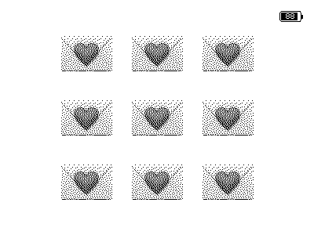
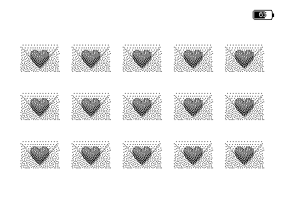
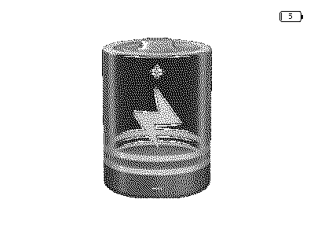

# PaperTalk-ESP32 💌

> **纸上寄语，静默陪伴。**  
> 一款基于 ESP32-S3 电子墨水屏与飞书开放平台（Lark OpenAPI）的双向亲子/家庭语音对讲终端。

[](https://idf.espressif.com/)
[](LICENSE)
[-orange.svg)]()
[](https://open.feishu.cn/)

---

## 🎨 界面视觉：极致克制的呼吸感

设备追求**“不打扰的科技感”**与**“真实的纸墨生命力”**：

| 待机状态（纯白留白） | 单封新留言（208px 居中） | 7 封信矩阵（上下均分） |
| :---: | :---: | :---: |
|  |  |  |
| **平时无消息**：全屏大面积留白，仅右上角显示内嵌电量 | **1 封信**：超大爱心信封居于全屏正中心 | **7 封信**：上 4 下 3 均分排布，平衡对称 |

| 3×3 完美九宫格（68px） | 3×5 满屏阵列（最多15封） | 🪫 5% 防过放关机屏 |
| :---: | :---: | :---: |
|  |  |  |
| **9 封信**：无缺角严格对齐，视觉工整严密 | **15 封信**：随着听完逐一减少，趣味直观 | **电量 ≤5%**：全刷锁定大插头并深睡防过放 |

---

## 💡 设计哲学：极致克制的交互体验

家里的幼儿还不认识汉字，但又渴望与经常在外出差、忙于工作的父母保持联系；市面上的儿童手表不仅伤眼，还充斥着繁杂的社交、游戏与视觉噪音。

**PaperTalk 专为学龄前孩子与家庭设计：**
- **没有消息时，极简到极致**：全屏大面积纯净留白，没有菜单、没有时钟、没有 Wi-Fi 信号跳动，**仅在右上角保留一个等边距的内嵌电量图标**。设备就像一张干净高级的书签，静默陪伴在书桌一角，不分散孩子一丝注意力。
- **有消息时，唤醒动态信封**：当父母从远方发来飞书语音，墨水屏静默浮现出精细的 **💌 爱心信封**。未读消息越多，信封阵列自动根据**最大对称法则**自适应扩展（支持 1 到 15 封）；孩子听完一封，信封就“拆开”消除一封，充满探索乐趣与仪式感。
- **完全零文字门槛**：全流程不需要孩子认识任何字，纯以图形和纯净提示音交流。
- **双向无缝桥接**：
  - **父母端**：打开手机上的**飞书 App**，直接像平时发消息一样给机器人发送一段语音；
  - **孩子端**：按下大按键即可听留言；如果一直按住直到播放结束，听到提示音后可以录音，松手发送给父母！

---

## ✨ 核心工程特性

### 1. 动态信封网格引擎（Max-Symmetry Grid Engine）
- **全屏几何重构**：彻底抹去传统虚拟状态栏高度，所有排布严格以屏幕物理中心点 $(200, 150)$ 展开。
- **自适应矩阵算法**：
  - $N=1$：超大 208px 信封居中；
  - $N=2$：双信封并排（146px）；
  - $N=3$：三信封横向排列（106px）；
  - $N=4$：2×2 均衡四宫格（92px）；
  - $N=5 \sim 6$：两行排布（上 3 下 2 / 上 3 下 3）；
  - $N=7 \sim 8$：两行排布（上 4 下 3 / 上 4 下 4）；
  - $N=9$：3×3 完美九宫格（68px，无缺角）；
  - $N=10$：2×5 严丝合缝十宫格（64px）；
  - $N=11 \sim 15$：3×5 矩阵（58px），最多完整呈现 15 封信！

### 2. 苹果 iOS 经典内嵌电量（Embedded Battery & Smart XOR）
- 电池图标严格贴合屏幕右上角，**外边距绝对等距统一**（`Top = 14px, Right = 14px`）。
- **数字与液位融为一体**：电量数字内嵌在电池内部，采用**像素级异或（XOR）反色算法**：
  - 满电时：整块黑色液位上浮现锐利的白色数字；
  - 半电时：文字左半边自动反白、右半边保持黑色；
  - 低电时：纯白底黑色数字。

### 3. 极速响应与防呆交互（Zero-Lag Feedback）
- **后台静默预下载（PSRAM Instant Cache）**：设备按消息 ID 预下载队首留言至 PSRAM。缓存就绪后播放不需要重新下载；缓存未就绪时会通过网络播放，实际出声时间仍受网络和音频开头静音影响。
- **反复聆听支持（Replay Mechanism）**：即使信封已消除或只剩待机白板，本地缓存依然保留上一条语音，孩子可以随时再次短按，**反复听爸爸妈妈说的话**。
- **首尾静音与背景降噪**：语音留言及回复会降低稳定的背景噪声，并仅裁剪首尾的低音量空白，保留句中停顿和一定的边缘余量；非常轻的声音会保留原样。音乐、人声交叠或突发噪声不能保证完全清除。
- **更宽容的按键**：按下即播放，连续短按不会暂停；保持最初的按键不松直到播放结束，听到提示音后录音，松手发送。没有留言或在处理待发送录音时，仍需长按约 1.2 秒。
- **松手即刻响应**：松开按键瞬间立即熄灭录音指示灯，体感零延迟。
- **空录音过滤**：接近纯静音的录音不发送；极轻的人声和环境噪声仍需在实际设备上验证。
- **克制灯光与零干扰**：来消息时不常亮 LED 指示灯，一切交给安静优美的电子墨水屏呈现。

### 4. 待机功耗优化
- **联网待机**：Wi-Fi 使用 DTIM Modem-sleep；设备空闲且没有外设电源管理锁时，可以自动进入浅睡眠，保持联网和原有按键轮询。
- **按需运行音频时钟**：播放或录音时启动 I²S，结束后停止；音频芯片电源保留，以便下次使用。
- **减少墨水屏刷新**：屏幕内容没有变化时跳过刷新；完成刷新后关闭屏幕供电。
- **电量检测**：每 5 分钟检查一次，仅在电量变化至少 2% 或充电状态改变时上报。
- **USB 调试**：连接电脑的 USB 串口时暂不自动浅睡眠，断开后恢复；实际待机电流和续航需在电池供电条件下测量。

### 5. 云端飞书长连接（无公网 IP / 零域名配置）
- 基于飞书官方提供的 **WebSocket 长连接（Lark WS Client）** 协议，服务端无需公网 IP、无需备案域名、无需配置 SSL 证书或内网穿透，开箱即用。

---

## 🛠️ 硬件清单

| 部件 | 规格 / 型号 | 备注 |
| :--- | :--- | :--- |
| **主控开发板** | **ZecTrix Note4 V1.0** (ESP32-S3-WROOM-1 N16R8V) | 16MB Flash, 8MB Octal PSRAM |
| **显示屏幕** | **400 × 300 Monochrome 1-bit EPD** (SSD1683 控制器) | 超清黑白电子墨水屏 |
| **音频编解码** | **ES8311 Codec** (I2C 控制 + I2S 数据) | 内置麦克风输入与扬声器功放输出 |
| **供电管理** | 锂电池检测 (ADC1 CH0) + 充电状态检测 GPIO | 支持 USB Type-C 充供电 |

---

## 🚀 快速上手

### 第一步：准备飞书机器人（企业自建应用）

1. 打开 [飞书开放平台](https://open.feishu.cn/)，登录并点击 **“创建企业自建应用”**。
2. 进入应用后台，在 **“凭证与基础信息”** 中复制获取：
   - `App ID` (例如 `cli_xxxxxxxxxxxxxxxx`)
   - `App Secret` (例如 `xxxxxxxxxxxxxxxxxxxxxxxxxxxxxxxx`)
3. 在左侧菜单点击 **“添加应用能力”** -> 选择 **“机器人”**。
4. 进入 **“权限管理”**，开通以下 3 项必要权限：
   - `获取用户发给机器人的单聊消息` (`im:message.p2p_msg:readonly`)
   - `获取与发送单聊、群聊消息` (`im:message:send_as_bot`)
   - `上传和下载文件/音视频` (`im:resource`)
5. 进入 **“事件与回调”** -> 找到 **“事件配置”**：
   - 模式选择：**【使用长连接获取事件】**（无需公网服务器与回调 URL！）
   - 点击 **“添加事件”**，勾选 **“接收消息 v2.0”** (`im.message.receive_v1`)。
6. 进入 **“版本管理与发布”**，点击 **“创建版本”** 并申请发布。

---

### 第二步：部署服务端（Server）

服务端可部署在 Linux 服务器等环境，以下依赖版本已在 Python 3.14 环境测试；还需要安装带 `libopus`、`libmp3lame` 支持的 FFmpeg（含 `ffprobe`）：

```bash
# 1. 克隆代码
git clone https://github.com/bandianliancha/PaperTalk-ESP32.git
cd PaperTalk-ESP32/server

# 2. 安装 FFmpeg（以下为 Debian / Ubuntu 示例）并创建虚拟环境
sudo apt install ffmpeg python3-venv
python3 -m venv .venv
source .venv/bin/activate
pip install -r requirements.txt

# 3. 配置飞书凭证
cp .env.example .env
nano .env  # 填入第一步获取到的 FEISHU_APP_ID 和 FEISHU_APP_SECRET
```

启动服务端：
```bash
python3 server.py
```
*(生产环境建议使用 `systemd` 守护进程，可参考仓库内的 `feishu_voice.service`)*

> 💡 **动态绑定特性**：服务端启动后，任何人只需用飞书给该机器人发一句文字或语音，服务端会自动将其绑定为当前设备的接收人，设备录音将直接回复给他！

---

服务端与固件的消息协议需要配套更新：部署此版本服务端后，也要烧录此版本固件。服务端在 `server/data/messages.sqlite3` 中保存未读队列和去重记录；保留该文件及对应音频文件可在服务重启后恢复消息。升级前旧版服务端内存中的未读队列无法自动迁移。

### 第三步：下载并烧录测试固件

已经运行本项目固件的 **ZecTrix Note4 V1.0 / ESP32-S3 N16R8** 用户，可下载 [按键与独立配网测试固件](firmware/releases/papertalk-esp32-test.bin)及其 [SHA-256 校验文件](firmware/releases/papertalk-esp32-test.bin.sha256)。这版已编译并通过基础逻辑测试，**尚未在真机上验证，请勿当作稳定版**。

1. 用支持数据传输的 USB 线连接设备，使用电脑上的 Chrome 或 Edge 打开 [乐鑫烧录工具](https://espressif.github.io/esptool-js/)。
2. 点击 **Connect** 选择设备，选择下载的 `.bin`，将 **Flash Address** 设置为 `0x10000`，点击 **Program**。
3. **不要勾选 Erase all，也不要点击 Erase Flash**；只写应用区，以保留现有 Wi-Fi 和待发送录音。请勿中途断电。
4. 固件不内置 Wi-Fi 凭据或服务器地址。首次配置、或升级后设备没有保存服务器地址时，连接设备热点 `PaperTalk-ESP32`，在浏览器打开 `http://192.168.4.1/`，输入自己的 2.4 GHz Wi-Fi、服务器 IP 或域名，以及服务器端口（不填端口时默认 80）。地址只填主机名或 IP，不填 `http://`、路径或端口；端口单独填写。
5. 设备会尝试连接服务器；请按下留言、按住至播放结束回复、无声回复等场景自行验证。每个家庭应使用自己部署的服务端；当前服务端的留言队列不按设备隔离。

**注意：**上面的单个 `.bin` 仅用于已刷入本项目兼容引导程序和分区表的设备。全新开发板需要先按下方源码编译方式烧录引导程序、分区表和固件。升级现有设备前应确认手头有可用的恢复方式；设备此前若没有保存服务端地址，更新后必须重新配网补填，否则不能收发留言。已有设备上待发送录音和 Wi-Fi 配置应保留，不要格式化。

### 从源码编译（Firmware）

固件基于 ESP-IDF v5.3+：

```bash
cd firmware
source /path/to/esp-idf/export.sh
idf.py set-target esp32s3
idf.py build
idf.py -p /dev/ttyUSB0 flash monitor  # 替换为实际串口
```

---

## 📱 交互说明

```text
 ┌────────────────────────────────────────────────────────┐
 │                    PaperTalk 极简交互                  │
 ├────────────────────────────────────────────────────────┤
 │                                                        │
 │   【短按大键 (Click)】     --->   立即播放最新语音信件   │
 │                                                        │
 │   【按住直到播放结束】 --->   哔一声开录，松手发送 │
 │                                                        │
 │   【侧键上 (Key Up)】      --->   音量增大 (800Hz 提示) │
 │                                                        │
 │   【侧键下 (Key Down)】    --->   音量减小 (最低 50%) │
 │                                                        │
 └────────────────────────────────────────────────────────┘
```

---

## 🤝 贡献与致谢

- 感谢 **ZecTrix** 团队打造了如此精巧的 Note4 墨水屏全集成硬件平台；
- 感谢 **Lark/Feishu 开放平台** 提供的优秀 WebSocket 长连接协议与 SDK；
- 欢迎提交 Issue 与 Pull Request！

---

## 📄 开源许可证

本项目基于 [MIT 许可证](LICENSE) 开源。欢迎家庭极客、创客教育与开源爱好者自由使用与二次创作！
