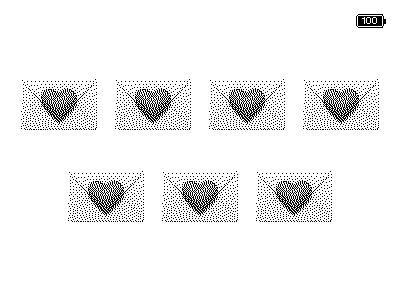
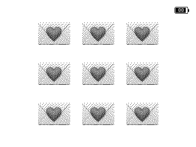
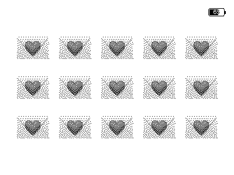
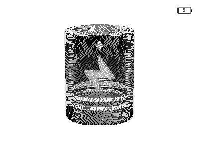

# PaperTalk-ESP32 💌

> **纸上寄语，静默陪伴。**  
> 一款基于 ESP32-S3 电子墨水屏与飞书开放平台（Lark OpenAPI）的双向亲子/家庭语音对讲终端。

[](https://idf.espressif.com/)
[](LICENSE)
[-orange.svg)]()
[](https://open.feishu.cn/)

---

## 🎨 界面视觉：极致克制的呼吸感

设备追求**“不打扰的科技感”**与**“真实的纸墨生命力”**：

| 待机状态（纯白留白） | 单封新留言（208px 居中） | 7 封信矩阵（上下均分） |
| :---: | :---: | :---: |
|  |  |  |
| **平时无消息**：全屏大面积留白，仅右上角显示内嵌电量 | **1 封信**：超大爱心信封居于全屏正中心 | **7 封信**：上 4 下 3 均分排布，平衡对称 |

| 3×3 完美九宫格（68px） | 3×5 满屏阵列（最多15封） | 🪫 5% 防过放关机屏 |
| :---: | :---: | :---: |
|  |  |  |
| **9 封信**：无缺角严格对齐，视觉工整严密 | **15 封信**：随着听完逐一减少，趣味直观 | **电量 ≤5%**：全刷锁定大插头并深睡防过放 |

---

## 💡 设计哲学：极致克制的交互体验

家里的幼儿还不认识汉字，但又渴望与经常在外出差、忙于工作的父母保持联系；市面上的儿童手表不仅伤眼，还充斥着繁杂的社交、游戏与视觉噪音。

**PaperTalk 专为学龄前孩子与家庭设计：**
- **没有消息时，极简到极致**：全屏大面积纯净留白，没有菜单、没有时钟、没有 Wi-Fi 信号跳动，**仅在右上角保留一个等边距的内嵌电量图标**。设备就像一张干净高级的书签，静默陪伴在书桌一角，不分散孩子一丝注意力。
- **有消息时，唤醒动态信封**：当父母从远方发来飞书语音，墨水屏静默浮现出精细的 **💌 爱心信封**。未读消息越多，信封阵列自动根据**最大对称法则**自适应扩展（支持 1 到 15 封）；孩子听完一封，信封就“拆开”消除一封，充满探索乐趣与仪式感。
- **完全零文字门槛**：全流程不需要孩子认识任何字，纯以图形和纯净提示音交流。
- **双向无缝桥接**：
  - **父母端**：打开手机上的**飞书 App**，直接像平时发消息一样给机器人发送一段语音；
  - **孩子端**：轻按大按键即可亲耳听到爸爸妈妈的声音；长按按键 300ms 录音，松手即刻直达父母飞书单聊！

---

## ✨ 核心工程特性

### 1. 动态信封网格引擎（Max-Symmetry Grid Engine）
- **全屏几何重构**：彻底抹去传统虚拟状态栏高度，所有排布严格以屏幕物理中心点 $(200, 150)$ 展开。
- **自适应矩阵算法**：
  - $N=1$：超大 208px 信封居中；
  - $N=2$：双信封并排（146px）；
  - $N=3$：三信封横向排列（106px）；
  - $N=4$：2×2 均衡四宫格（92px）；
  - $N=5 \sim 6$：两行排布（上 3 下 2 / 上 3 下 3）；
  - $N=7 \sim 8$：两行排布（上 4 下 3 / 上 4 下 4）；
  - $N=9$：3×3 完美九宫格（68px，无缺角）；
  - $N=10$：2×5 严丝合缝十宫格（64px）；
  - $N=11 \sim 15$：3×5 矩阵（58px），最多完整呈现 15 封信！

### 2. 苹果 iOS 经典内嵌电量（Embedded Battery & Smart XOR）
- 电池图标严格贴合屏幕右上角，**外边距绝对等距统一**（`Top = 14px, Right = 14px`）。
- **数字与液位融为一体**：电量数字内嵌在电池内部，采用**像素级异或（XOR）反色算法**：
  - 满电时：整块黑色液位上浮现锐利的白色数字；
  - 半电时：文字左半边自动反白、右半边保持黑色；
  - 低电时：纯白底黑色数字。

### 3. 极速响应与防呆交互（Zero-Lag Feedback）
- **后台静默预下载（PSRAM Instant Cache）**：飞书推送新留言后，设备在刷新墨水屏的同时，**后台自动把音频无感预下载至 8MB 八线 PSRAM**。孩子按键播放时，**零网络握手等待，毫秒级瞬间出声**！
- **反复聆听支持（Replay Mechanism）**：即使信封已消除或只剩待机白板，本地缓存依然保留上一条语音，孩子可以随时再次短按，**反复听爸爸妈妈说的话**。
- **300ms 极速长按判定**：20ms 硬件消抖 + 280ms 状态锁定，按下 0.3 秒即可开录，搭配超短 40ms 清脆提示音。
- **松手即刻响应**：松开按键瞬间立即熄灭录音指示灯，体感零延迟。
- **0.3 秒误触过滤**：若孩子无意快速轻点按键，系统自动丢弃无声噪音片段，不打扰父母。
- **克制灯光与零干扰**：来消息时不常亮 LED 指示灯，一切交给安静优美的电子墨水屏呈现。

### 4. 极致超低功耗体系
- **Wi-Fi DTIM Modem-sleep**：与 AP 协商 Beacon 自动休眠，待机电流下降 70%。
- **硬件级电源彻底锁止（GPIO Hold）**：墨水屏刷新后切断电源并执行硬件引脚锁止，静态漏电流降至 0μA。
- **自适应电量心跳**：延长至 5 分钟定时检测，且仅在电量波动 $\ge 2\%$ 时发包。
- **5% 终极防过放保护**：当电量降至 5% 且未充电时，屏幕全刷锁定 🪫 充电图标，芯片进入 **10μA Deep Sleep**，彻底保护锂电池寿命。

### 5. 云端飞书长连接（无公网 IP / 零域名配置）
- 基于飞书官方提供的 **WebSocket 长连接（Lark WS Client）** 协议，服务端无需公网 IP、无需备案域名、无需配置 SSL 证书或内网穿透，开箱即用。

---

## 🛠️ 硬件清单

| 部件 | 规格 / 型号 | 备注 |
| :--- | :--- | :--- |
| **主控开发板** | **ZecTrix Note4 V1.0** (ESP32-S3-WROOM-1 N16R8V) | 16MB Flash, 8MB Octal PSRAM |
| **显示屏幕** | **400 × 300 Monochrome 1-bit EPD** (SSD1683 控制器) | 超清黑白电子墨水屏 |
| **音频编解码** | **ES8311 Codec** (I2C 控制 + I2S 数据) | 内置麦克风输入与扬声器功放输出 |
| **供电管理** | 锂电池检测 (ADC1 CH0) + 充电状态检测 GPIO | 支持 USB Type-C 充供电 |

---

## 🚀 快速上手

### 第一步：准备飞书机器人（企业自建应用）

1. 打开 [飞书开放平台](https://open.feishu.cn/)，登录并点击 **“创建企业自建应用”**。
2. 进入应用后台，在 **“凭证与基础信息”** 中复制获取：
   - `App ID` (例如 `cli_xxxxxxxxxxxxxxxx`)
   - `App Secret` (例如 `xxxxxxxxxxxxxxxxxxxxxxxxxxxxxxxx`)
3. 在左侧菜单点击 **“添加应用能力”** -> 选择 **“机器人”**。
4. 进入 **“权限管理”**，开通以下 3 项必要权限：
   - `获取用户发给机器人的单聊消息` (`im:message.p2p_msg:readonly`)
   - `获取与发送单聊、群聊消息` (`im:message:send_as_bot`)
   - `上传和下载文件/音视频` (`im:resource`)
5. 进入 **“事件与回调”** -> 找到 **“事件配置”**：
   - 模式选择：**【使用长连接获取事件】**（无需公网服务器与回调 URL！）
   - 点击 **“添加事件”**，勾选 **“接收消息 v2.0”** (`im.message.receive_v1`)。
6. 进入 **“版本管理与发布”**，点击 **“创建版本”** 并申请发布。

---

### 第二步：部署服务端（Server）

服务端使用 Python 3.10+ 开发，可部署在任何 Linux 服务器、云主机（轻量云）或家庭软路由/树莓派上：

```bash
# 1. 克隆代码
git clone git@github.com:bandianliancha/PaperTalk-ESP32.git
cd PaperTalk-ESP32/server

# 2. 安装依赖 (推荐在虚拟环境中运行)
pip3 install -r requirements.txt

# 3. 配置飞书凭证
cp .env.example .env
nano .env  # 填入第一步获取到的 FEISHU_APP_ID 和 FEISHU_APP_SECRET
```

启动服务端：
```bash
python3 server.py
```
*(生产环境建议使用 `systemd` 守护进程，可参考仓库内的 `feishu_voice.service`)*

> 💡 **动态绑定特性**：服务端启动后，任何人只需用飞书给该机器人发一句文字或语音，服务端会自动将其绑定为当前设备的接收人，设备录音将直接回复给他！

---

### 第三步：编译与烧录固件（Firmware）

项目固件基于 **ESP-IDF v5.3+** 编写：

```bash
cd ../firmware

# 1. 加载 ESP-IDF 环境变量
source /path/to/esp-idf/export.sh

# 2. 设置默认连接的 Wi-Fi 与服务端 IP
# 可以在 main/main.c 中修改 DEFAULT_SERVER_HOST、WIFI_SSID
# (设备亦自带 SoftAP 自动配网界面，连不上 Wi-Fi 时屏幕会提示手机热点配网)

# 3. 编译并刷入 Note4
idf.py set-target esp32s3
idf.py build
idf.py -p /dev/ttyUSB0 flash monitor  # 替换为你的真实串口端口
```

---

## 📱 交互说明

```text
 ┌────────────────────────────────────────────────────────┐
 │                    PaperTalk 极简交互                  │
 ├────────────────────────────────────────────────────────┤
 │                                                        │
 │   【短按大键 (Click)】     --->   立即播放最新语音信件   │
 │                                                        │
 │   【长按大键 300ms (Hold)】 --->   哔一声开录，松手即发送 │
 │                                                        │
 │   【侧键上 (Key Up)】      --->   音量增大 (800Hz 提示) │
 │                                                        │
 │   【侧键下 (Key Down)】    --->   音量减小 (安全底线60%) │
 │                                                        │
 └────────────────────────────────────────────────────────┘
```

---

## 🤝 贡献与致谢

- 感谢 **ZecTrix** 团队打造了如此精巧的 Note4 墨水屏全集成硬件平台；
- 感谢 **Lark/Feishu 开放平台** 提供的优秀 WebSocket 长连接协议与 SDK；
- 欢迎提交 Issue 与 Pull Request！

---

## 📄 开源许可证

本项目基于 [MIT 许可证](LICENSE) 开源。欢迎家庭极客、创客教育与开源爱好者自由使用与二次创作！
